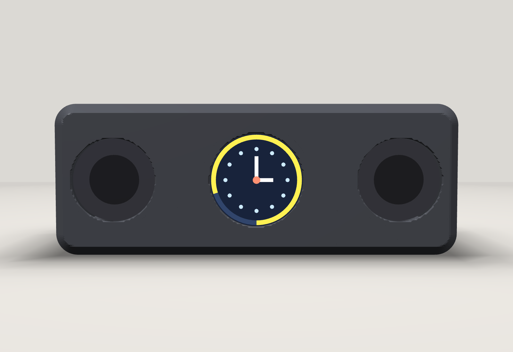
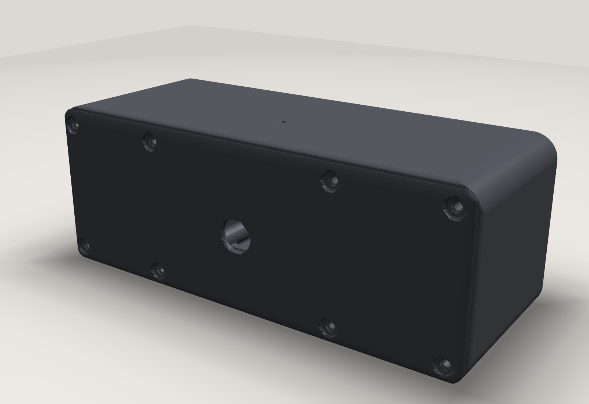

[English](README.md) | Română

# Puck – telecomandă Home Assistant (ESP32-S3, ecran rotund 1,28")

Cele trei STL-uri mari (corpul barei, corpul cutiei cu difuzor, corpul bazei pentru display) sunt la pagina [Releases](../../releases).

Telecomandă cu ecran rotund tactil pentru Home Assistant, bazată pe ESPHome, cu asistent vocal (Jarvis), ceas, alarmă, control muzică (Music Assistant) și popup de sonerie cu poză de la cameră. În repo sunt și carcasele 3D imprimabile.

## Hardware

**Placa „Puck":** DeepSeek AI Voice Chat Robot BOX 1.28inch TouchScreen ESP32-S3 Development Board 1.28 inch Round LCD N16R8 for XiaoZhi (Spotpear). ESP32-S3 N16R8 (16 MB flash, 8 MB PSRAM), ecran rotund tactil 240×240, microfon și difuzor.

**Pentru bara cu difuzoare (D1):** ESP32-S3-Zero, amplificator MAX98357, microfon INMP441, 2 difuzoare Ø40 mm 3 W 4 Ω, mufă DC-022 (vezi `3d/bara-d1/PRINT.ro.md`).

## Structura

| Folder | Conținut |
|---|---|
| `esphome/` | firmware-ul Puck (`puck-telecomanda.yaml`, `puck_slot.yaml`, `secrets.yaml.example`) |
| `homeassistant/` | automatizări: sincronizarea stărilor și soneria |
| `3d/` | carcase imprimabile: `bara-d1` |
| `docs/` | `INSTALARE.md` – pas cu pas |

## Început rapid

1. Citește `docs/INSTALL.ro.md`.
2. Copiază `esphome/secrets.yaml.example` ca `secrets.yaml` și completează valorile.
3. Flashează prin USB, apoi actualizările merg prin WiFi (OTA).

## Funcții

- 8 pagini (swipe), câte o entitate pe pagină, inel colorat pe margine (lumini galben, temperatură albastru–roșu)
- pagină muzică cu cover de album, volum, timer de somn
- pagină Favorite (3 radiouri + 1 playlist din Music Assistant)
- alarmă cu creștere treptată a volumului
- ceas analogic în standby cu temperatură și vreme
- popup sonerie cu poză de la cameră (opțional)
- reducerea luminozității automat noaptea, pagină de diagnoză
- entități setabile din Home Assistant (nume, pictogramă, tip, entitate pe fiecare slot)

## Licență

Cod și configurări: MIT (vezi `LICENSE`). Modele 3D (STL): CC BY 4.0.
